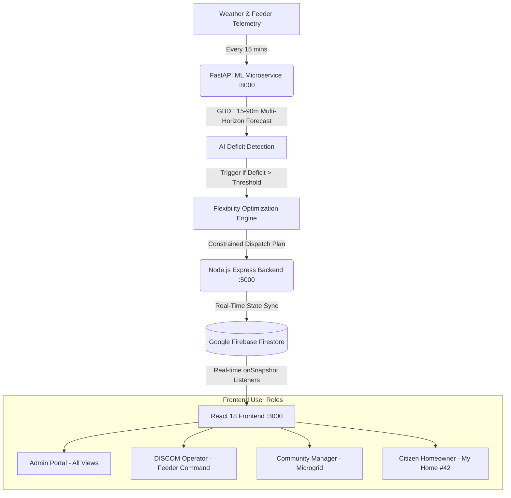

# ⚡ GRIDSENSE AI — COMPLETE PROJECT WORKFLOW & ARCHITECTURE MANUAL

> **Theme 1 — Grid Reliability: Renewable Intermittency**  
> *"Predict. Optimize. Balance. Making clean power dependable, neighbourhood by neighbourhood."*

---

## 1. Executive Summary

As neighbourhoods adopt rooftop solar, clean energy generates abundant power during the day. However, between **17:30 and 19:30**, solar generation drops sharply to near zero just as families return home, switch on air conditioning, and plug in electric vehicles. 

This creates the classic **"Solar Cliff"** or Duck Curve, causing local distribution transformers to overheat, feeder lines to trip, and utilities (DISCOMs) to fire up expensive, polluting diesel generators or impose rolling blackouts.

**GridSense AI** solves this at the neighbourhood level (100 homes per sub-grid) through **autonomous AI forecasting, flexible load orchestration, and community battery coordination**, ensuring **100% protection for critical infrastructure** (medical clinics, refrigeration) and rewarding participating households.

---

## 2. High-Level System Architecture



### The 4 Architecture Layers:
1. **Tier 1 — User Interface (React 18 + Vite + Tailwind CSS)**:
   - Responsive, accessible dashboard with **Dark Mode & Light Mode** toggle.
   - Distinct, tailored role experiences (`ADMIN`, `DISCOM_OPERATOR`, `COMMUNITY_MANAGER`, `USER`).
   - Interactive SVG energy flow diagrams, What-If simulation slider, and AI Copilot.
2. **Tier 2 — Coordination & API Layer (Node.js Express on Port 5000)**:
   - Aggregates sub-grid data across 100 homes, manages alert lifecycles, and executes scenario overrides.
3. **Tier 3 — AI & Optimization Engine (Python FastAPI on Port 8000)**:
   - **Gradient Boosted Decision Tree (GBDT)** multi-horizon predictor (15m, 30m, 60m, 90m ahead).
   - Constrained optimization solver balancing battery discharge (max 0.5C), EV deferral, AC thermal drift, and water heat pump scheduling.
4. **Tier 4 — Cloud State & Real-Time Sync (Firebase Firestore `gridsense-4b9d8`)**:
   - Real-time `onSnapshot` subscriptions pushing feeder telemetry, demand response statuses, and critical alerts instantly to all connected users.

---

## 3. The 15-Minute Optimization Lifecycle (Step-by-Step)

```
[17:30 IST] ➔ Step 1: Telemetry Ingestion (Solar: 140 kW, Feeder Draw: 180 kW, Battery SoC: 85%)
                ▼
[17:31 IST] ➔ Step 2: Multi-Horizon GBDT AI Forecast (Predicts solar decay to 22 kW by 18:30)
                ▼
[17:32 IST] ➔ Step 3: Deficit Alert Raised (Anticipated Deficit: 110 kW at 18:00 Peak)
                ▼
[17:33 IST] ➔ Step 4: Optimization Solver Executes 4 Non-Negotiable Rules:
                      1. Rule A: 100% Critical Load Protection (Medical Clinic + Refrigeration).
                      2. Rule B: Community Battery Floor (Never discharge below 20% SoC).
                      3. Rule C: Pre-Cooling & Water Storage (Thermal buffers charged before 17:30).
                      4. Rule D: EV Smart Deferral (35 EVs paused until 22:00 off-peak with ₹180 rebate).
                ▼
[17:34 IST] ➔ Step 5: Real-Time Dispatch to Firestore ➔ Feeders Stabilized at 72% Load.
```

---

## 4. Role-Based Experiences & Tailored Personas

GridSense AI rectifies identical-dashboard fatigue by providing distinct UI views tailored to each user's exact responsibilities:

### Persona 1: Citizen Prosumer (`USER` — Home #42)
*Target: Homeowners, apartment residents, EV owners.*
- **Dedicated Route**: `/my-home`
- **What they see**:
  - **Live Rooftop Generation**: 4.2 kW generating, 1.8 kW exported to community battery.
  - **Monthly Rebates**: ₹1,850 credited to their power bill for participating in demand response.
  - **Tata Nexon EV Charger Control**: 1-click toggle between *"Smart Delay (Earn ₹180)"* and *"Charge Now (Emergency Override)"*.
  - **Inverter AC Eco-Drift**: Transparent comfort assurance showing +1.5°C temporary adjustment during peak solar cliff.
  - **Essential Power Guarantee**: Green badge confirming medical, refrigeration, and WiFi circuits are 100% protected.

### Persona 2: DISCOM Feeder Operator (`DISCOM_OPERATOR`)
*Target: State electricity board engineers, substation control room staff.*
- **Dedicated Route**: `/discom`
- **What they see**:
  - **Feeder Substation Telemetry**: Real-time load across FDR-001, FDR-002, FDR-003, FDR-004.
  - **Overload Warnings**: Instant alert when feeder exceeds 85% rated capacity.
  - **Automated Demand Response Dispatch**: 1-click trigger to shed up to 80 kW of flexible load across the feeder without rolling blackouts.
  - **Grid Substation Map**: Interactive geographic map (`/map`) showing feeder health and transformer hotspots.

### Persona 3: Community Microgrid Manager (`COMMUNITY_MANAGER`)
*Target: Housing society presidents, microgrid operators, smart city leads.*
- **Dedicated Route**: `/` (Microgrid Dashboard)
- **What they see**:
  - **100-Home Aggregate Telemetry**: Total generation, baseline consumption, and net grid exchange.
  - **100 kWh LiFePO4 Community Battery (`/battery`)**: Real-time SoC, discharge C-rate, thermal status, and 20% floor reserve enforcement.
  - **AI Flexibility Plan (`/flexibility`)**: Full explainability breakdown of how the ML engine allocated flexible loads.
  - **What-If Simulator (`/simulator`)**: Interactive stress-test tool allowing managers to simulate cloudy days, EV surges, or battery failures.

### Persona 4: System Administrator (`ADMIN`)
*Target: Technical evaluators, hackathon judges, platform admins.*
- **Access**: Full system access to all 12 platform tabs, ML model hyperparameters, and telemetry controls.

---

## 5. Dark Mode & Light Mode Feature

GridSense AI features an integrated dual-theme design system:
- **Dark Mode (Default)**: Deep obsidian background (`#030712`), glowing emerald/cyan neon accents, low-light control room aesthetics.
- **Light Mode**: High-contrast, clean corporate aesthetic with crisp cards, refined slate typography, and gentle ambient shadows.
- **How to Toggle**:
  - Click the **Sun / Moon** icon in the top-right navigation bar anytime.
  - Your theme preference is automatically remembered across sessions in `localStorage`.

---

## 6. How to Start and Run the Project

The entire system runs locally with a single script:

### Quick Launch
Double-click `start.bat` in the root folder, or run:
```bash
./start.bat
```

This concurrently launches:
1. **Python ML Service**: `http://localhost:8000` (FastAPI + GBDT Engine)
2. **Node.js Express Backend**: `http://localhost:5000` (Orchestration & Firestore Sync)
3. **React Vite Client**: `http://localhost:3000` (User Interface)

### Stopping the Services
Run `stop.bat` to cleanly terminate all background node and python processes.

---

## 7. Interactive Judge Demo Walkthrough

When presenting GridSense AI to judges:
1. Open `http://localhost:3000` in your browser.
2. Click **"START DEMO"** in the top navigation bar to launch the guided 6-step interactive walkthrough.
3. Switch themes using the **Sun / Moon** toggle to demonstrate visual adaptability.
4. Use the **Role Switcher** in the top bar to switch between:
   - **Prosumer Citizen** (`USER`) ➔ Show the user-friendly Home #42 portal and ₹180 EV delay incentive.
   - **DISCOM Operator** (`DISCOM_OPERATOR`) ➔ Show the Feeder Command Center and Demand Response dispatch.
   - **Community Manager** (`COMMUNITY_MANAGER`) ➔ Show the What-If Simulator and 100 kWh battery floor reserve.
